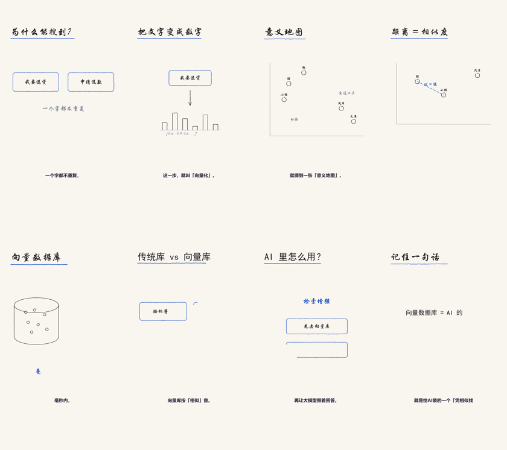
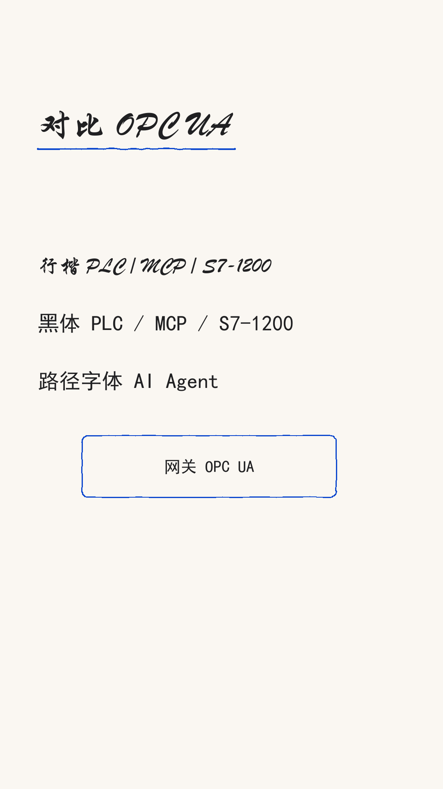

# 技术讲解视频 · handdrawn-tech-video-skill

> **一句话主旨 → 竖版手绘讲解短片（1080×1920，抖音 / 视频号 / 小红书直发）。**
> 画面跟着配音走：说到「网关」两个字，网关的框就在那一刻开始画。

[](LICENSE)
[](requirements.txt)

<sub>
**English note** — A WorkBuddy / Claude **Agent Skill** that turns one technical sentence into a
vertical (1080×1920) hand-drawn explainer video. Strokes are **audio-synced** via word-level TTS
timestamps, so there is **zero manual timing**. Visuals are code-generated vector line art rather
than AI images, which means **Chinese text is always rendered correctly**. Requires Python +
Pillow + edge-tts (>=7) + imageio-ffmpeg (ffmpeg bundled). See [快速开始](#快速开始).
</sub>

---

## 这是什么

技术号做手绘讲解视频，常见两条路都不好走：

- **AI 生图**：中文必错字，改一句话要重抽一版图
- **人工对时间轴**：几分钟的视频要逐镜标「第几秒画什么」，改稿等于重做

本技能走第三条路：**画面是代码生成的矢量线稿**。由此换来三件事：

| | 本技能 | 典型 AI 生图方案 |
|---|---|---|
| 中文字 | **零错字**（矢量文本渲染） | 常见错字、异体字 |
| 改稿成本 | **只改 JSON**，重新渲染即可 | 重画、重新抽卡 |
| 声画同步 | **自动**，词级时间戳对齐 | 靠手感，或逐镜人工标注 |
| 画面质感 | 偏冷、板书感 | 温暖、插画感 |

核心机制一句话：

1. `voice.py` 用 edge-tts 合成配音，同时取回**每个词**的起止时刻
2. `timeline.py` 把 shot.json 里每个图元声明的 `cue` 词，映射成它的出场时刻
3. `animate.py` 按这个时间轴逐笔绘制每一帧

所以声画同步是**自动**的 —— 不需要任何人工标注。

## 效果预览

本技能渲染风格的真实输出（向量库主题，多帧拼版）：



同一句话在不同字体下的观感对比 —— 这是下文「术语必须换黑体」那条规则的由来：



想看动态效果：执行下面的[快速开始](#快速开始)，30 秒内你就能得到一段 mp4。

## 适用场景与它不干的活

| 需求 | 用什么 |
|---|---|
| **连续手绘讲解成片（竖版、发抖音）** | **本技能** |
| 单张白板手绘解说图（静态） | `白板手绘解说图` |
| 横版精品白板长片（8 步流程、人工标区域） | `whiteboard-video-studio` |
| AI 生图 + 运镜的「数字相册」式短视频 | `ZLW_ZH_AI短视频流水线` |

定位差异一句话：**画面是代码生成的矢量线稿，不是 AI 生图。**
技术类内容（架构、流程、对比、原理）用本技能；情感 / 故事类不合适。

## 环境要求

| 能力 | 组件 |
|---|---|
| 渲染 | Pillow ≥ 10（超采样抗锯齿） |
| 配音 | edge-tts ≥ 7（免费、无需 Key、**需要联网**） |
| 合视频 | ffmpeg —— 由 `imageio-ffmpeg` 自带，**无需单独安装** |
| 字体 | Windows 系统字体自动择优：`STXINGKA.TTF` 行楷 → `simkai.ttf` 楷体 → 微软雅黑 |

## 安装

### 1. 作为 Agent Skill 安装

这是一个标准 Agent Skill（带 `SKILL.md` frontmatter）。**安装 = 把整个目录放进 skills 目录**：

```bash
git clone https://github.com/liwen16_hub/handdrawn-tech-video-skill.git

# WorkBuddy
cp -r handdrawn-tech-video-skill "C:/Users/<你的用户名>/.workbuddy/skills/ZLW_技术讲解视频"

# Claude Code
cp -r handdrawn-tech-video-skill ~/.claude/skills/ZLW_技术讲解视频
```

> 目录名建议保持 `ZLW_技术讲解视频`，与 `SKILL.md` 的 `name` 字段一致。

### 2. Python 依赖

```bash
pip install -r requirements.txt -i https://pypi.tuna.tsinghua.edu.cn/simple
```

### 3. 字体

脚本从系统字体目录读取，**字体不随仓库分发**（避免字体授权问题）。

- **Windows**：开箱即用，自动在 `行楷 → 楷体 → 微软雅黑` 中择优
- **其它系统**：自备一款手写中文字体，在 shot.json 顶层用 `"font"` 指定绝对路径

### 4. 验证 ffmpeg

```bash
python -c "import imageio_ffmpeg; print(imageio_ffmpeg.get_ffmpeg_exe())"
```

能打印出一个 `ffmpeg-*.exe` 路径即正常。

## 快速开始

用仓库自带的 `examples/demo-shot.json` 跑通最小闭环。**在本仓库根目录执行**：

```bash
# 0) 设定路径
PY="python"            # 或你的 python 绝对路径
SK="$(pwd)"            # 本仓库根目录
PRJ="$SK/examples/out" # 输出目录（已在 .gitignore 中）

# 1) 配音 + 词级时间戳 + SRT
#    文本取自 demo-shot.json 里的 voice_text，必须与之一致
"$PY" "$SK/scripts/voice.py" \
  --text "很多人以为，网关就是个转发器。其实它真正的职责，是隔离和汇聚。" \
  --out-dir "$PRJ" --voice xiaoxiao

# 2) 时间轴 + 密度体检
"$PY" "$SK/scripts/timeline.py" "$SK/examples/demo-shot.json" "$PRJ/voice.json"

# 3) 先出单帧预览（3.5 秒处），确认版式再渲染全片，省时间
"$PY" "$SK/scripts/animate.py" "$SK/examples/demo-shot.json" "$PRJ/timeline.json" \
      -o x.mp4 --preview 3.5 --preview-out "$PRJ/frame.png"

# 4) 渲染成片（--scale 2 为超采样倍率：慢一倍，线条明显更顺；赶时间用 1.5）
"$PY" "$SK/scripts/animate.py" "$SK/examples/demo-shot.json" "$PRJ/timeline.json" \
      -o "$PRJ/shot-01.mp4" --audio "$PRJ/voice.mp3" --scale 2
```

**成功标志**：`examples/out/` 下出现
`voice.mp3` / `voice.srt` / `voice.json`、`timeline.json`、`shot-01.mp4`。

> 第 1 步需要联网 —— edge-tts 走微软的公共在线服务。
> 若 `timeline.py` 打印 `[注意]` 告警，说明这一镜图元超载，先回去减图元或拆镜。

## 六步工作流

| 步骤 | 做什么 | 产出 | 详见 |
|---|---|---|---|
| 0 定三件事 | 主旨 / 受众 / 目标时长（**45–90 秒最优**） | —— | `references/script-method.md` |
| 1 写口播脚本 | 一镜 = 一个信息点 = 3–8 秒 | `script-*.txt` | `references/script-method.md` |
| 2 写 shot.json | 把每镜要画的东西翻译成图元坐标（**工作量大头**） | `shot-*.json` | `references/contract.md` + `primitives.md` |
| 3 配音 + 时间轴 | 词级时间戳 → 出场时刻，并做密度体检 | `voice.*` / `timeline.json` | 脚本内注释 |
| 4 渲染 | 逐帧绘制 → 竖版 mp4（**不含字幕**） | `shot-*.mp4` | —— |
| 5 验收 | 逐字核对 / A 点 / 同步 / 字幕 / 尾帧 | —— | 见[验收清单](#验收清单) |
| 6 拼接烧字幕 | 多镜 concat + 统一 ASS 字幕 | `final.mp4` | `scripts/join.py` |

两处**必须**读 `references/`：第 1 步（方法论）和第 2 步（字段契约 + 版式模板）。

**字幕必须最后统一烧。** `animate.py` 逐镜产出的是无字幕片段 —— 每镜单独烧会在缝合处出现样式跳变；而且字幕时间轴是「相对本镜」的，只有拼接之后才知道每镜的全局起点。

```bash
"$PY" "$SK/scripts/join.py" -o "$PRJ/final.mp4" \
      --clip "$PRJ/shot-01.mp4" "$PRJ/shot-02.mp4" \
      --voice "$PRJ/voice-01.json" "$PRJ/voice-02.json"
```

`--clip` 与 `--voice` 按相同顺序给，数量必须一致。

## 规范速查

| 项 | 值 |
|---|---|
| 画幅 | 1080×1920（9:16 竖版） |
| 帧率 | 30 fps |
| 图元密度 | ≤ 配音秒数 × 0.55 |
| 单屏图元 | ≤ 5 |
| 字幕安全线 | y ≤ 1536 |
| 单条字幕 | ≤ 16 字，距底 20% |
| 字幕提前量 | `lead = 0.14s`（画面先于声音） |
| 手绘速度 | 780 px/s（约 1.2 秒画一个 320×140 框） |
| 逐字速度 | 0.125 秒/字 |
| 推荐时长 | 45–90 秒 |
| 编码 | H.264 + AAC，crf 20 |
| 图元类型 | `title` `text` `box` `arrow` `line` `group` `dot` `scatter` `cylinder` `bars` |

**复合作图能绕开密度约束。** `scatter`（散点图）不管里面放几个点，都只算**一个**图元 —— 「聚类 / 相似度 / 向量空间」这类内容，一张散点图就能装下，比拆成四五个框划算得多。`cylinder`（数据库圆柱）、`bars`（向量条）同理。用法见 `references/primitives.md` 模板 E / F。

## 验收清单

1. **中文逐字核对** —— 这是本方案的核心优势，出现错字说明混入了图片素材
2. **A 点检查** —— 每镜开头 0.5s 内第一个图元是否已开始落笔
3. **同步检查** —— cue 词被念出的瞬间，对应图元是否刚起笔（允许提前约 0.14s）
4. **字幕** —— 不出现在 `y > 1536` 之外，单行 ≤ 16 字
5. **结尾** —— 最后一个图元画完后至少停 0.8s

## 踩坑与设计约束

1. **绘制节奏跟不上语音节奏 —— 这是设计约束，不是 bug。**
   手绘速度固定为 780 px/s，8 秒配音只能承载 4–5 个图元。`timeline.py` 用 `[注意]` 告警兜住这一点；硬跑会让图元「唰」地闪出，失去手绘感。看到告警就减图元或拆镜。

2. **词级时间戳必须显式要。**
   `Communicate(..., boundary="WordBoundary")` —— edge-tts ≥ 7 默认是 `SentenceBoundary`，拿不到词级时间戳，字幕和同步全废。这也是 `requirements.txt` 里写 `edge-tts>=7` 的原因。

3. **cue 顺序必须与绘制顺序一致。**
   数组里第 3 个图元的 cue 若比第 2 个更早，第 2 个会被顺延，同步失效。写 shot.json 时按语音顺序排图元。

4. **行楷写拉丁字母不可读。**
   实测 `AI` 会被看成 `A7`。主题词、术语、数字必须给**该元素**单独指定 `"font": "sans"`（黑体）—— 改的是元素，不是整镜字体。

5. **TTS 读法必须逐条试听。**
   `PLC` / `OPC UA` / `MCP` / `S7-1200` 可能被读成字母或整词，与画面预期不符。旁白里写读得对的写法，画面可保留缩写 —— 文本层与旁白本来就可以不同。

6. **字幕不能白字。**
   纸底是暖白 `[250,247,242]`，白字完全看不见。`join.py` 已固化为「墨黑文字 + 纸色描边」，位置 `MarginV=400`（≈ y=1520）。

7. **中文路径要用 `C:/` 正斜杠。**
   Windows 下给 Python 传路径要用 `C:/...` 形式；Git Bash 的 `/c/...` 只在部分场景被自动转换，写在 `python -c` 字符串里必定失败。

其余实测坑（共 14 条）见 [`SKILL.md`](SKILL.md) 末尾。

## 目录结构

```
handdrawn-tech-video-skill/
├── SKILL.md                        技能定义与完整流程（Agent 读这个）
├── requirements.txt
├── references/
│   ├── contract.md                 shot.json 字段契约（必读）
│   ├── primitives.md               图元画法与版式参考
│   └── script-method.md            口播脚本方法论
├── scripts/
│   ├── voice.py                    配音 + 词级时间戳 + SRT
│   ├── timeline.py                 词级时间戳 → 图元出场时间轴 + 密度体检
│   ├── sketch.py                   手绘图元引擎（10 种图元 + 抖动 + 逐笔绘制）
│   ├── animate.py                  逐帧渲染 → 竖版 mp4（无字幕）
│   └── join.py                     多镜拼接 + 统一烧字幕 → 成片
└── examples/
    ├── demo-shot.json              最小可跑示例（4 个图元）
    ├── primitives-showcase.json    复合作图示例（散点 / 圆柱 / 向量条）
    ├── font-compare.png            字体对比
    ├── vector-db-contact-sheet.png 渲染风格示例
    └── out/                        运行后生成，已被 .gitignore 排除
```

## 局限与适用边界

- **合适的**：架构、流程、对比、原理拆解类技术内容。
- **不合适的**：情感故事、需要温度与氛围的内容 —— 画面偏冷、有板书感。
- **平台**：Windows 优先（字体取自系统目录）；其它平台需自备手写中文字体。
- **联网**：配音走 edge-tts 公共在线服务，偶发超时（`voice.py` 已内置 3 次重试）。
- **时长**：单条成片建议 45–90 秒；超过 2 分钟必须靠强钩子撑。

## 许可

[MIT](LICENSE) © 2026 liwen16_hub

字体不随仓库分发，各行其原有授权。
